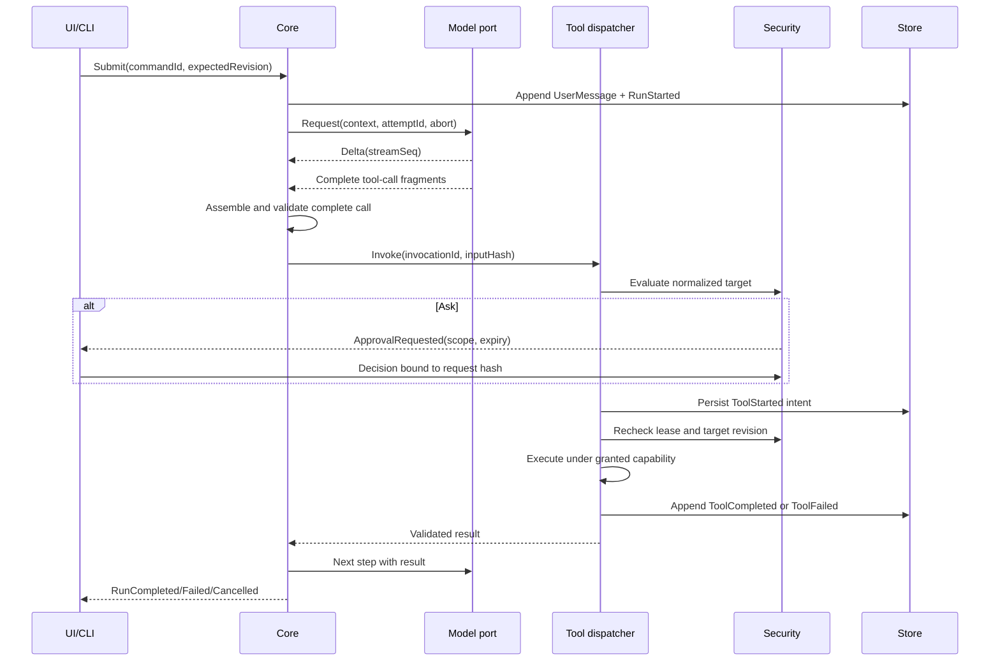

# Luồng sự kiện và tính nhất quán

**Not implemented.** Events và commands tuân theo [contract](../contracts/agent-events.md). Core giữ một sequencer cho session writer lease. Thứ tự bảo đảm bằng `sessionSeq` của durable events, không dựa timestamp; các delta ephemeral dùng `streamSeq` trong attempt. Không có total order giữa sessions.

Không dispatch khi thiếu arguments hoặc stream kết thúc bất thường. Tool-call fragments keyed bởi attempt/call ID, bytes và nesting bị giới hạn. Tool descriptors chốt tại step start; registry reload không thay schema giữa approval và execution. Result được validate, giới hạn kích thước và gắn provenance trước đưa vào hội thoại.

Cancel chuyển run sang cancelling, phát abort tới model/tools/MCP/children. Timeout không chứng minh process đã dừng; tool side effect không xác định phải `outcome_unknown`. Terminal event chỉ một lần theo compare-and-set run revision; late deltas bị loại khỏi active transcript. UI có thể nhận diagnostic late completion, không tự mở lại run.

Retry chỉ cho lỗi tạm thời có bounded backoff/jitter, deadline và budget; new attemptId, giữ logical commandId. Idempotency key không tạo exactly-once với shell/remote MCP. Persist invocation intent trước side effect; khi crash giữa side effect và result, reconcile theo filesystem/Git hoặc remote receipt, nếu không có thì hỏi người dùng. Không tự replay write/shell.

Client reconnect gửi last durable seq; server replay > cursor rồi follow stream từ watermark, tránh gap giữa snapshot và subscribe. Deltas đã mất không được replay giả; gửi canonical message snapshot và stream reset. Backpressure coalesce text deltas, không bỏ permission/outcome events. Store append failure ngăn bước tiếp theo; error event chưa durable phải được báo lỗi transport rõ ràng.
