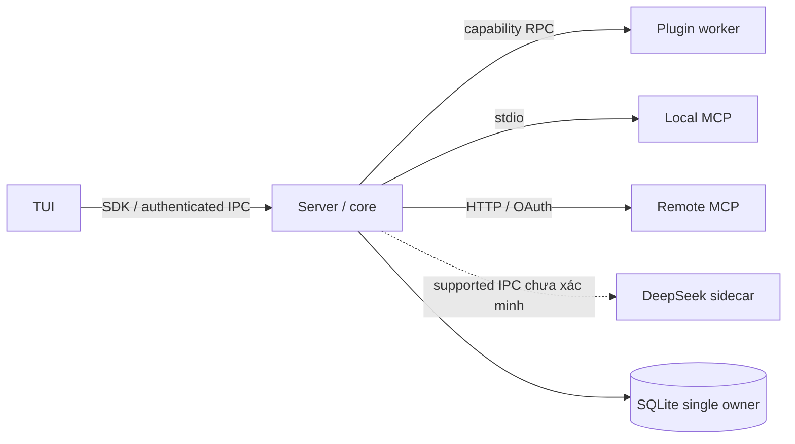

# Process model

**Not implemented.** Process isolation quản lý lỗi/lifecycle; chỉ OS sandbox với policy được kiểm chứng mới là security boundary.

| Process | Sở hữu | IPC và trust |
|---|---|---|
| CLI headless | Embedded runtime và SQLite writer cho local run | Không transport UI; vẫn dùng contracts và policy |
| Server | Runtime, session leases, event sequencer, stores | Authenticated HTTP commands; WebSocket events dự kiến |
| TUI | Editor, render, reconnect cursor | SDK tới server; không DB/tool handles |
| Plugin worker | Extension lifecycle, granted proxy services | Versioned request/response, deadlines, correlation IDs |
| Local MCP server | Dịch vụ ngoài qua stdio | Spawn binary đã duyệt; stdin/stdout protocol, stderr redacted |
| Remote MCP server | Server mạng không đáng tin | Streamable HTTP và OAuth; URL/origin policy |
| DeepSeek sidecar | Runtime dsh nếu supported interface được xác minh | Không giả định HTTP/RPC tồn tại; chọn giao thức sau khảo sát |

Local TUI launcher khởi động một managed server, chờ health/auth handshake, giữ child PID và shutdown ownership. Kết nối server đã tồn tại không sở hữu lifecycle server. Embedded headless và server không được đồng thời ghi cùng session; SQLite lock không thay session fencing lease. Web/desktop chưa có host.

IPC envelope có protocolVersion, requestId, method, deadline, cancellation token, bounded payload; response lỗi có retryability và outcome certainty. Không serialize functions/raw handles. Endpoint local dùng private socket hoặc loopback token, permissions file chặt, không bind public mặc định. Remote auth/workspace authorization được kiểm mỗi command/subscription.

Startup: resolve config → validate policies → acquire storage migration/writer locks → initialize providers → extension/MCP optional connections → publish ready. Optional service failure thể hiện degraded capability; bắt buộc service thiếu thì fail startup. Không tải plugin trước policy.

Shutdown: ngừng nhận run mới → cancel/drain active runs theo deadline → đánh dấu unknown invocations → dispose hooks theo thứ tự ngược → close MCP/children → flush durable/audit queues → release DB/leases. Kill chỉ sau grace timeout; platform process-tree semantics cần tests riêng.

Crash recovery: startup đọc nonterminal runs, fence writer cũ, đối chiếu tool receipts/checkpoint/workspace revision. Không tự chạy lại commands. Plugin crash hủy registrations theo generation; MCP reconnect renegotiate capabilities; sidecar restart không phục hồi object references cũ. [Persistence](../subsystems/persistence.md) quy định recovery.
