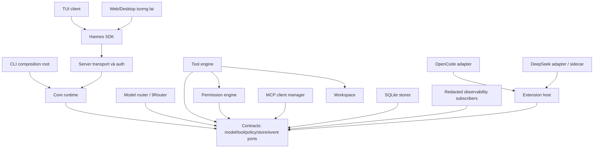

# Kiến trúc hệ thống

**Đề xuất Phase 0; Not implemented.** Hannes dùng contracts-first monorepo, domain runtime headless và composition tại apps. Nguồn cảm hứng và giới hạn bằng chứng nằm trong [catalog](../delivery/dependency-catalog.md) và các tài liệu compatibility; ranh giới dưới đây là quyết định Hannes, không phải mô tả implementation private upstream.

Mũi tên biểu thị phụ thuộc compile-time. Khi chạy, core gọi ports do models/tools/security/persistence cung cấp. Event bus là port trong contracts, không phải package mới: per-session sequencer do core sở hữu, durable append do persistence, transport replay do server. Observability subscribers đặt ở composition roots, chính sách redaction do security. Không dùng bus để lách ownership bằng cách gửi command side effect không kiểm quyền.

CLI có thể embed runtime trong headless mode hoặc kết nối server; TUI chỉ là client, local mode khởi động server cục bộ được quản lý. Server sở hữu runtime/session writer trong mode client-server; không chạy thêm loop trong TUI. Local headless có cùng contract và permission gate. Remote mode thêm xác thực, tenant/workspace scope, transport encryption; không coi localhost đáng tin tuyệt đối.

Core sở hữu state machine, context assembly, stop/retry và orchestration một run. Model router chọn endpoint theo profile/capabilities/budget; không thực thi tools. Tool engine kiểm schema, dispatch và kiểm kết quả; security đánh giá Allow/Ask/Deny trước side effect; workspace kiểm path và version khi commit thay đổi. Extension host quản lý lifecycle và capability grants; MCP manager là client của servers ngoài. Compatibility adapters dịch APIs/hook semantics, không định nghĩa agent loop hay permission thứ hai.

SQLite giữ event log, sessions/checkpoints; audit là luồng đã redacted với retention riêng. Runtime state có thể dựng lại từ durable events; token deltas không cần durable từng ký tự. Tất cả model/tool/plugin output là dữ liệu chưa tin cậy.

Failure domains: provider timeout chỉ kết thúc attempt; plugin timeout có thể disable plugin; store append failure chặn hành động tiếp theo; server crash cần reconcile invocation đang chạy; client disconnect không tự hủy run nếu policy detach cho phép. [Process model](process-model.md) và [event flow](event-flow.md) quy định chi tiết.

Các ADR: [runtime](../adr/0001-typescript-bun.md), [contracts](../adr/0002-contracts-first.md), [compatibility](../adr/0003-plugin-compatibility.md), [security](../adr/0004-security-boundary.md). Rust, GUI host, transport RPC cụ thể và Cordis A/B chưa được chốt.
