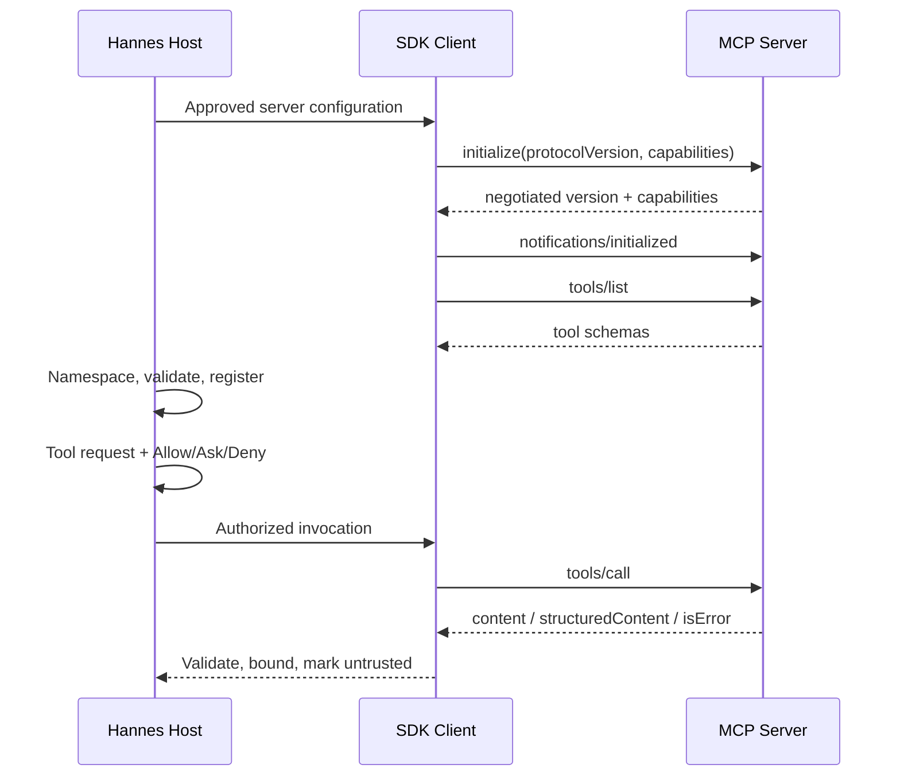

# MCP compatibility

**Not implemented.** Nguồn truy cập 2026-11-13: [SDK v2](https://ts.sdk.modelcontextprotocol.io/v2/), [v2.4.0 docs](https://github.com/modelcontextprotocol/typescript-sdk/tree/v2.4.0/docs), [upgrade guide](https://github.com/modelcontextprotocol/typescript-sdk/blob/v2.4.0/docs/migration/upgrade-to-v2.md), [OAuth client](https://github.com/modelcontextprotocol/typescript-sdk/blob/v2.4.0/docs/clients/oauth.md), [transport API](https://ts.sdk.modelcontextprotocol.io/v2/api/shared/transport.html). Đây là evidence documentation, chưa là Bun runtime tests hay npm package pins.

Hannes là Host, mỗi configured server có một Client connection; MCP Server là external process/service cung cấp capabilities. Dùng SDK chính thức. SDK major v2 không phải protocol version 2: initialize negotiate protocol revision độc lập. Pin client/core/server/node adapters theo cùng release sau dependency review; Hannes chỉ cần client để consume, không mặc nhiên cần server package. v1 @modelcontextprotocol/sdk không drop-in source-compatible với v2 split packages; stdio import chuyển vào client/stdio hoặc server/stdio, không root neutral barrels. v2 bỏ SSE/WebSocket transports trong surface đã khảo sát; Hannes WebSocket event transport không liên quan.

| Surface | Mapping Hannes | Invariant / acceptance |
|---|---|---|
| stdio | Managed local process + SDK client transport | stdout chỉ protocol; env allowlist; crash unregister |
| Streamable HTTP | SDK transport và OAuth provider | TLS/origin rules, session headers theo SDK; reconnect không replay effects |
| Capabilities | Registry snapshot sau initialize | Không gọi feature không advertised |
| tools | Namespaced descriptor → ToolPort | Hannes permission trước tools/call; output validation sau response |
| resources | Scoped list/read/subscription nếu supported | URI không tự fetch, limits/provenance/permission riêng |
| prompts | Scoped list/get với arguments | Returned messages untrusted; không override policy |
| notifications | SDK handlers → capability/events | list_changed refresh nếu advertised; epochs loại stale updates |
| cancellation/progress | Abort/deadline mapping | Cancel không chứng minh remote rollback; progress bounded |

Lifecycle: discovered → configured → connecting → initializing → ready → reconnecting/closing → closed/failed. List pagination bounded; duplicate names đổi bằng stable server namespace, không dùng tool display name làm identity. Tool key gồm server identity/tool name/schema generation, tránh server thay tools giữa approval/execution. Server identity đổi endpoint/issuer/executable hash thì invalidate grants.

Result validation phân biệt JSON-RPC protocol error, tool `isError`, valid content và schema violations; structured output kiểm schema nếu declared. Images/resource links chỉ dereference qua authorized read; result không được thực thi như instructions. Preserve original tool error provenance, sanitize secrets, store large content như artifacts.

OAuth remote servers: SDK discovery/PKCE helpers + app-owned state check, bind tokens/registration/discovery/verifier vào authorization-server issuer và resource. SDK docs nói app phải tự so sánh redirect state; không bỏ bước đó. Callback allowlist, state single-use/TTL, secure OS storage cho refresh tokens, không lưu trong repo/session/log. finishAuth xong dùng fresh transport theo docs, không restart started transport. Refresh scope chỉ opt-in khi AS yêu cầu; token revocation xóa cached grants, không loop login. Không chuyển model provider key cho MCP. Dynamic registration/redirect/metadata URLs phải qua SSRF và origin policy.

Failure handling: stdio exit/HTTP timeout → abort local request, classify unknown remote side effect, fence connection epoch, reconnect với backoff/deadline; initialize lại và refresh schemas. Chỉ retry safe reads hoặc có idempotency guarantee server được kiểm chứng. Authorization expired có bounded refresh; denied scope không tự request quyền rộng hơn. Explicit close unregister descriptors và drain/abort calls.

Conformance gate: initialize version mismatch, stdio stderr flood/crash, HTTP stream interruption/session expiration, two OAuth flows, wrong state/issuer/audience, revoked token, tools/list_changed, oversized/malformed result, prompts/resources policy, cancel racing completion. Các tests chưa chạy. Bun stdio/Web Crypto/HTTP compatibility, exact protocol revisions và npm v2 package engines còn Needs verification. Xem [subsystem](../subsystems/mcp-integration.md) và [matrix](compatibility-matrix.md).
