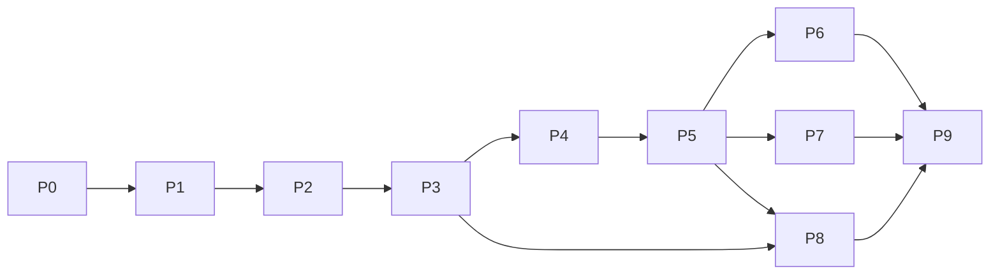

# Implementation roadmap

Mọi capability tương lai: **Not implemented**. Phase 0 không thực thi các tasks/test requirements dưới đây. Không có thời gian ước lượng cam kết. Mỗi phase có review scope và security gate; dependency hoàn thành không tự cho phép mở rộng phase đang được giao.

Graph là prerequisites; thứ tự roadmap giữ P0–P9. P1 có minimum permission gate bắt buộc cho local tools; P2 mở rộng persistence/UX/revocation, không trì hoãn enforcement đến P2. P4 trước P5 trong delivery order; extensions vẫn không import MCP implementation. P8 sandbox không làm các phase trước được phép quảng cáo chạy untrusted plugins an toàn.

## Phase 0: Scaffold & Architecture Documentation

**Objectives:** Đặt boundaries, ownership, contracts và nguồn nghiên cứu đủ để triển khai có kiểm chứng.

**In scope:** Đúng baseline source rỗng, Markdown đầy đủ, sources/version caveats, ADRs.

**Out of scope:** Mọi implementation, dependency install, configs/build/test/application.

**Dependency graph:** Không có phase tiền nhiệm; đọc 6 nguồn công khai trước thiết kế.

**Implementation tasks:** Tạo placeholders; viết 5 contracts, 11 subsystem specs, compatibility, catalog và ADR; link toàn bộ navigation.

**Test requirements:** Chỉ kiểm kê filesystem/bytes, nội dung Markdown, link nội bộ và forbidden artifacts; không chạy tests.

**Acceptance criteria:** 118 TS/TSX 0 byte; mọi .gitkeep 0 byte; docs có nội dung và mapping đủ từng file; không có implementation.

**Exit gate:** Báo cáo số lượng/tree và kết quả kiểm tra; dừng tại Phase 0.

**Risks:** Upstream thay đổi, exact package pins/Bun compatibility chưa chứng minh; ghi Needs verification.

## Phase 1: Contracts, Core Runtime, 9Router, local tools

**Objectives:** Có vertical slice headless với contracts và permission gate tối thiểu ngay từ tool đầu tiên.

**In scope:** Contracts validators/ports; core single loop; 9Router sau identity xác minh; read/write/edit/search/shell tối thiểu có policy.

**Out of scope:** TUI, durable resume, MCP/plugins, subagents và sandbox claims.

**Dependency graph:** P0 → contracts → policy enforcement tối thiểu → provider/tools → core composition.

**Implementation tasks:** Chốt public schemas và 9Router endpoint/auth fixtures; đánh giá dependencies rồi mới tạo manifests/config hợp lệ; implement port adapters; core stop conditions; CLI headless slice.

**Test requirements:** Schema/property cases, malformed fragmented calls, path boundaries, deny/ask headless, usage unknown, tool timeout và duplicate invocation.

**Acceptance criteria:** Một task qua endpoint đúng và tools trả receipts; mọi execution có enforcement; core không import UI/provider SDK.

**Exit gate:** Contract review + dependency/license/Bun evidence + tests của slice pass; chưa claim unrestricted safety.

**Risks:** 9Router identity/capabilities chưa rõ; shell noncancellable. Local tools không được phát hành trước minimum policy gate.

## Phase 2: Streaming, persistence, permissions và TUI

**Objectives:** Có tương tác stream, session bền và human approval rõ ràng.

**In scope:** Normalized deltas; SQLite event/session transactions; approval ledger/revoke; OpenTUI client và server protocol cần thiết.

**Out of scope:** Advanced recovery, plugins, MCP, GUI.

**Dependency graph:** P1; event contract → durable sequencing + permissions → transport/SDK → TUI.

**Implementation tasks:** Hoàn thiện Allow/Ask/Deny scopes/expiry; journal invocation intents; event replay cursor; partial message snapshots; TUI permission dialog/diff/output controls; server auth cho selected local topology.

**Test requirements:** Crash trước/sau commit, approval persisted trước display, two clients approval CAS, seq gaps/reconnect, terminal escape output, Ctrl-C và stream backpressure.

**Acceptance criteria:** Restart giữ transcript; pending/expired approval đúng trạng thái; no partial tool call execution; TUI không truy cập DB/executor.

**Exit gate:** Durability + security + interface acceptance pass; supported topology ghi rõ.

**Risks:** SQLite/FS atomic gap; OpenTUI native packaging; không triển khai full remote deployment chỉ để có local server.

## Phase 3: Context, recovery, Git, code intelligence

**Objectives:** Resume an toàn, context budget thực tế và code retrieval có freshness.

**In scope:** Project instructions/compaction/cache; reconciliation; Git receipts/worktrees; rg/LSP/Tree-sitter staged.

**Out of scope:** MCP/plugins, distributed scheduling, unverified auto rollback.

**Dependency graph:** P2 → workspace revisions/checkpoints → recovery/context; intelligence cần workspace invalidation.

**Implementation tasks:** Chốt token accounting; preserve source history; reconcile unknown tools; Git dirty-tree safeguards; LSP position encoding; index generation và watcher overflow.

**Test requirements:** Compaction drift/constraints, source stale, symlink races, Git conflicts, external edits, LSP crash, power-loss và migration recovery.

**Acceptance criteria:** Resume không replay shell/write mù; context nằm trong verified window; stale results tagged; user edits không mất.

**Exit gate:** Recovery fault scenarios và context evaluation thresholds được định nghĩa, đạt; diagnostics không giả build success.

**Risks:** Model tokenizer không chính xác, index stale, shell effects không thể reconcile hoàn toàn.

## Phase 4: MCP integration

**Objectives:** Host MCP dùng SDK chính thức với transports/auth/permission đúng.

**In scope:** stdio, Streamable HTTP, capability negotiation, tools/resources/prompts và OAuth.

**Out of scope:** Legacy transports, expose Hannes MCP server, custom protocol implementation.

**Dependency graph:** P2 permission/storage; P3 recovery; catalog v2/Bun review → connection manager → registry → invocation mapping.

**Implementation tasks:** Pin v2 split packages/protocol fixtures; namespacing; OAuth vault/state/PKCE; result validation; reconnect/epoch fencing; credentials UI.

**Test requirements:** Official SDK interop, two transport fixtures, malicious schema/result, server crash, unknown remote effects, OAuth issuer/state/token revoke, cancellation.

**Acceptance criteria:** Denied tool không gửi tới server; results bounded/untrusted; reconnect renegotiates; no credentials in logs.

**Exit gate:** Conformance matrix cho selected revisions pass và unresolved transport limitations công khai.

**Risks:** SDK release drift, remote server non-idempotence, OAuth metadata SSRF.

## Phase 5: Skills, hooks, plugin lifecycle

**Objectives:** Extension host có scoped services và cleanup có thể kiểm chứng.

**In scope:** Manifest/discovery, trusted loading, capability grants, hooks, skill provenance, commands và reload.

**Out of scope:** OpenCode/Cordis parity, marketplace và arbitrary untrusted in-process execution.

**Dependency graph:** P2 permissions/storage + P3 context + P4 registry patterns; extension contracts → lifecycle ledger → loading/hook surfaces.

**Implementation tasks:** Chốt host kinds và install review; registration rollback; hook timing/order; generation swap; bounded callbacks; skill assembly.

**Test requirements:** Init/dispose failure, dependency cycles, reload inflight, revoked grants, malicious skills, package provenance và ambient access.

**Acceptance criteria:** No leaked registrations; unsupported hosts explicit; in-process trusted-only; transforms không bypass policy.

**Exit gate:** Lifecycle + privilege invariants pass; mỗi exposed service có permission coverage.

**Risks:** JS ambient quyền; dependency loader side effects; executable configuration.

## Phase 6: OpenCode compatibility

**Objectives:** Chứng minh subset V1/V2 riêng theo plugin/host capability.

**In scope:** V1 adapter; V2 server; SDK/RPC bridges; TUI subset sau host conformance.

**Out of scope:** GUI compatibility claim khi desktop host chưa có; private OpenCode internals.

**Dependency graph:** P5 extension host + P2 SDK/TUI; pin host/package APIs → corpus → translation → differential conformance.

**Implementation tasks:** Inventory V1 declarations; map model/tool/session methods/errors; preserve sync transforms; package exports/discovery; TUI host probes; RPC codecs/version negotiation.

**Test requirements:** Golden plugins upstream vs Hannes, cleanup/reload, sync order, remote TUI, unsupported methods, permission failures.

**Acceptance criteria:** Mỗi supported row có exact versions và passing fixtures; GUI vẫn Not implemented/unsupported target nếu chưa có host.

**Exit gate:** Capability report xuất bằng chứng, không dùng import success hoặc phần trăm marketing.

**Risks:** Fast API drift, experimental GUI và incompatible renderer/Effect runtime.

## Phase 7: DeepSeek Cordis compatibility

**Objectives:** Chọn A/B/hybrid dựa API và tests, không theo giả định.

**In scope:** Context/Service, fiber/effects, event bridges, profiles/bundles/reload; sidecar feasibility.

**Out of scope:** Fork toàn dsh hoặc invented sidecar API, executable untrusted config.

**Dependency graph:** P5 lifecycle + P3 recovery; pin vendor/fork → API inventory → A/B spikes trong phạm vi phase → ADR → selected adapters.

**Implementation tasks:** So sánh fork với vendor/upstream; validate supported IPC; service proxy enforcement; fixture profile precedence/HMR; chọn route duy nhất mỗi capability.

**Test requirements:** DI missing/replacement/cycle, fiber failures, async cleanup, event modes, ordered patches, reload race, sidecar crash/cancel/security.

**Acceptance criteria:** A/B/hybrid được giải thích bằng evidence; không privileged bypass; unsupported capabilities có diagnostics.

**Exit gate:** ADR chốt strategy và per-capability differential tests pass trước công bố support.

**Risks:** Không có supported IPC đủ mediation; version deltas; lifecycle mismatch; không bắt buộc chọn sidecar.

## Phase 8: Subagents, background tasks, sandbox

**Objectives:** Delegation bounded và isolation được kiểm chứng trên OS hỗ trợ.

**In scope:** Task DAG/queue, child budget reservations, background ownership/cancel, OS sandbox selected platforms.

**Out of scope:** Unlimited fanout, distributed clusters, blanket cross-platform sandbox claim.

**Dependency graph:** P3 recovery/worktrees + P5 grants/lifecycle; sandbox có thể nghiên cứu sớm nhưng enable gate ở đây.

**Implementation tasks:** Launcher port; context snapshots; task leases/epochs; parent review/merge; budget accounting; verify OS process-tree/filesystem/network enforcement.

**Test requirements:** Budget races, recursive delegation, parent cancel, worker crash, conflicting edits, child privacy, sandbox escape attempts và unavailable backend.

**Acceptance criteria:** Không overspend reserved budget; child grants là subset; supported OS constraints thật sự enforced; unsupported fail closed.

**Exit gate:** Adversarial security + scheduler fault tests pass; OS support matrix công khai.

**Risks:** OS differences, children survive kill, shared .git state, runaway model costs.

## Phase 9: Advanced interfaces, plugin marketplace, conformance

**Objectives:** Hoàn thiện interface hosts và công bố compatibility bằng evidence.

**In scope:** Web/desktop hosts, GUI plugin renderer/main surfaces, marketplace provenance, stable conformance reports.

**Out of scope:** Tuyên bố 100% parity, private API support vô hạn, deployment tự phát.

**Dependency graph:** P6/P7 capability adapters + P8 security; desktop host design ADR → GUI integration → distribution review → conformance release.

**Implementation tasks:** Chọn frameworks bằng ADR; per-window/main grants; remote auth/tenancy; signed/integrity package workflow; publish versioned supported/unsupported matrix.

**Test requirements:** GUI multiwindow/main lifecycle, remote auth, package tampering/rollback, cross-host RPC, end-to-end conformance corpus và opt-in telemetry.

**Acceptance criteria:** Mỗi advertised feature có artifact evidence/version/platform scope; GUI chỉ compatible sau own host tests.

**Exit gate:** Security review + release conformance + docs/contracts migration policy đạt; user-authorized publish separate action.

**Risks:** Supply-chain trust, GUI experimental churn, maintenance matrix explosion.

Tham chiếu [test strategy](test-strategy.md), [threat model](threat-model.md), [compatibility matrix](../compatibility/compatibility-matrix.md). Thay đổi gate/contract/ownership cần ADR. Kết thúc Phase 0 không chạy Phase 1.
