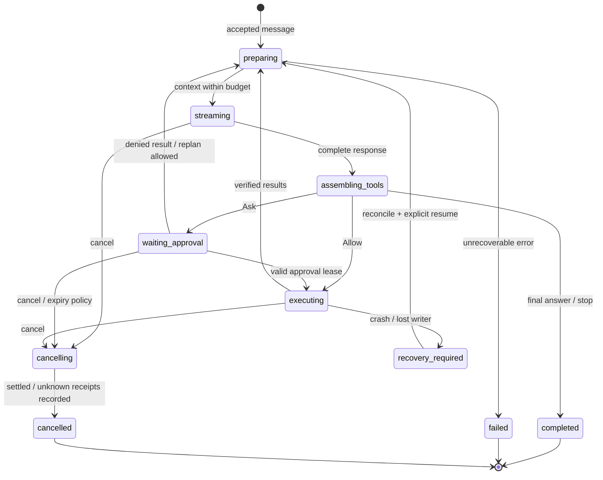

# Agent runtime

**Trạng thái: Not implemented.** Mọi lifecycle và acceptance dưới đây là đặc tả cho phase tương lai.

## 1. Mục đích và phạm vi

Điều phối một run từ user intent tới terminal outcome, độc lập CLI/TUI. Plan tạo kế hoạch/read; Build cho phép đề xuất writes/execute; Review đọc diff và đề xuất kiểm chứng. Mode không tự cấp quyền.

## 2. Trách nhiệm sở hữu

Core sở hữu run/step/attempt state, context orchestration, stop conditions và per-session sequencing. agent/engine giữ state machine; loop điều phối lượt; step giữ một model response và tool batch; bootstrap/shutdown quản lý ports.

## 3. Ngoài trách nhiệm

Không sở hữu provider wire formats, UI, SQLite connections, OS sandbox, plugin ABI hay policy evaluation. Delegation dùng injected launcher, không gọi core khác bằng private API.

## 4. Input, output và dữ liệu sở hữu

Input: accepted message, pinned profile/config, transcript, budgets và ports. Output: domain events, model requests, validated tool requests và final outcome. Owned state: run revision, active attempt, pending invocation IDs, budget ledger; durable representation do store giữ.

## 5. Xử lý và lifecycle

idle → preparing → streaming → assembling_tools → waiting_approval/executing → preparing; từ mọi nonterminal có thể cancelling → cancelled hoặc recovery_required. completed/failed là terminal. Sau ToolResult, verify receipt rồi thêm message đúng callId và bắt đầu step mới. Stop khi model stop, explicit cancel, budget/step/deadline limit, policy deny không thể tiếp tục hoặc unrecoverable error. Không dùng recursive model tools tự chạy ngoài loop.

Sơ đồ rút gọn; cancel áp dụng mọi nonterminal theo event contract. Terminal budget/limit outcome phải có stopReason; denied tool có thể thành result để replan, không tự retry action bị deny. `recovery_required` cần lưu interrupted generation rồi tạo resumed run/epoch, không khôi phục live handles.

## 6. Dependencies và interface boundaries

Chỉ import contracts. ModelPort, ToolPort, PolicyPort, StorePort, EventPort và AgentLauncher được composition root inject. Tool dispatcher kiểm quyền; core không có privileged executor. Contract agent-events/model-provider là public boundary.

## 7. Luồng sự kiện

RunStarted → StepStarted → ModelDelta → ModelCompleted → ToolRequested → ApprovalRequested/Resolved → ToolStarted → ToolCompleted → StepStarted → RunCompleted. Mọi durable event đi qua cùng sequencer; UI chỉ subscriber. Xem event-flow.

## 8. Errors, cancellation và recovery

Provider retry bounded chỉ cho transient errors; step/attempt ID tách riêng. Tool retry chỉ khi idempotent hoặc có receipt chứng minh chưa thực thi. Cancel abort model/tool/children, giữ unknown effects để reconcile. Resume từ checkpoint không replay side effects; late results bị fenced theo epoch.

## 9. Concurrency, races và timeout

Một active run writer/session; reads cùng snapshot có thể song song, tool writes được serialize theo canonical target. Step token ledger reserve trước request, settle bằng usage; thiếu usage dùng estimate có flag. Deadlines connect/idle/total/approval riêng, thời gian chờ approval không tiêu CPU nhưng vẫn có expiry. Child budgets reserve từ parent, không mint thêm.

## 10. Security considerations

Không cho model/tool text thay policy hay trusted instructions. Approvals bind args hash và target revision. Tool verification là executor receipt và đọc lại/diff phù hợp, không hỏi model để coi là thành công. Persist intent trước tool; audit sau mọi quyết định.

## 11. Thư viện dự kiến và alternatives

Bun/TypeScript; AI SDK qua models port. Alternative: direct HTTP adapters hoặc Rust core, chỉ revisit nếu profiling/Bun incompatibility có bằng chứng. Không để AI SDK agent loop thành owner thứ hai.

## 12. Acceptance criteria và test cases

Cases: single read rồi final answer; interleaved tool fragments chỉ execute sau complete; Plan bị chặn write; deny/cancel khi waiting approval; budget hết giữa stream; duplicate command; crash sau shell start; resume workspace khác revision; child fail không nhân đôi run. Pass khi terminal một lần và không có unapproved effects.

## 13. Quyết định mở và rủi ro

Chưa chốt default limits, behavior khi một tool trong batch deny, checkpoint frequency và detachable runs. Rủi ro: provider usage thiếu, tool không cancellable, unknown outcomes. Những giá trị này phải được chốt bằng ADR/config trước phase tương ứng.

Tham chiếu: [contracts](../contracts/agent-events.md), [tools/permissions](../contracts/tools-and-permissions.md), [dependencies](../architecture/dependency-rules.md), [event flow và sequence diagram](../architecture/event-flow.md), [catalog](../delivery/dependency-catalog.md), [roadmap](../delivery/implementation-roadmap.md).
